<picture>
  <source media="(prefers-color-scheme: dark)" srcset="assets/typing-dark.svg">
  <source media="(prefers-color-scheme: light)" srcset="assets/typing-light.svg">
  
</picture>

  
  
  
  

## Sobre mí

<picture>
  <source media="(prefers-color-scheme: dark)" srcset="assets/header-dark.svg">
  <source media="(prefers-color-scheme: light)" srcset="assets/header-light.svg">
  
</picture>

Construyo la parte que no se ve: **APIs, autenticación, bases de datos y la infraestructura que las pone en producción**. Me gusta llevar un proyecto de la idea al servidor: diseño del API, seguridad, despliegue con Docker, CI/CD y monitoreo.

*EN: Backend developer from Hermosillo, Mexico. I build APIs, auth flows, data layers and the Linux/Docker infrastructure that runs them. Open to junior backend roles, on-site or remote.*

<picture>
  <source media="(prefers-color-scheme: dark)" srcset="assets/numbers-dark.svg">
  <source media="(prefers-color-scheme: light)" srcset="assets/numbers-light.svg">
  
</picture>

## Proyectos

<a href="https://github.com/Xavier82h8/franken-panel-showcase">
  <picture>
    <source media="(prefers-color-scheme: dark)" srcset="assets/franken-panel-dark.svg">
    <source media="(prefers-color-scheme: light)" srcset="assets/franken-panel-light.svg">
    
  </picture>
</a>

<a href="https://github.com/Xavier82h8/musa-ai-showcase">
  <picture>
    <source media="(prefers-color-scheme: dark)" srcset="assets/musa-ai-dark.svg">
    <source media="(prefers-color-scheme: light)" srcset="assets/musa-ai-light.svg">
    
  </picture>
</a>

<a href="https://github.com/Xavier82h8/musaaudio-showcase">
  <picture>
    <source media="(prefers-color-scheme: dark)" srcset="assets/musaaudio-dark.svg">
    <source media="(prefers-color-scheme: light)" srcset="assets/musaaudio-light.svg">
    
  </picture>
</a>

> El código de estos proyectos es privado. Cada tarjeta lleva a su ficha técnica con capturas, arquitectura, decisiones de seguridad y lo que aprendí. **La demo y la revisión del código en vivo están disponibles bajo solicitud.**

## Stack

  
   
  

| Área | Herramientas |
|---|---|
| Backend | Node.js, TypeScript, Express, Fastify, Python, FastAPI, REST, WebSockets, SSE |
| Autenticación | JWT, OAuth 2.0 / OpenID Connect con PKCE, Sign in with Apple, RBAC, cookies seguras + CSRF |
| Datos | PostgreSQL, Redis, SQLite, MongoDB, Prisma, SQLAlchemy (async), Alembic |
| DevOps | Docker Compose, Nginx, Caddy, GitHub Actions, Linux, systemd, Bash, Prometheus |
| Testing | Jest, pytest, `node:test`, pruebas E2E y de carga |
| IA / ML | PyTorch, Hugging Face (Transformers, PEFT, TRL), QLoRA, llama.cpp / GGUF |

## Experiencia

**Desarrollador Web (Servicio Social)** · Gobierno del Estado de Sonora · 2025
Login con Google y Apple, integración de métodos de pago y conexión de la base de datos con el frontend en una plataforma de alcance estatal.

## Ahora mismo

- Preparando el siguiente ciclo de entrenamiento de MUSA-AI con un dataset propio de **47 153 ejemplos** validados.
- Franken Panel y MUSA-AI siguen en desarrollo activo.
- Buscando mi primer puesto como **Backend Developer Jr**, en Hermosillo o remoto.

